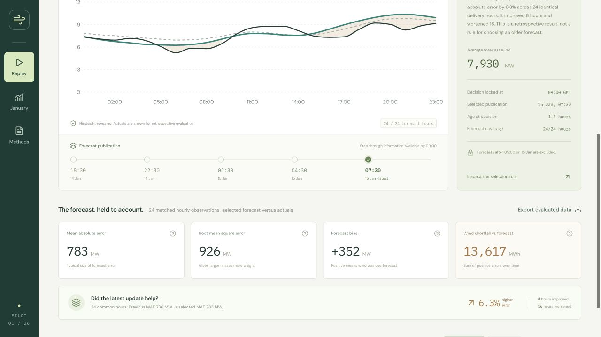
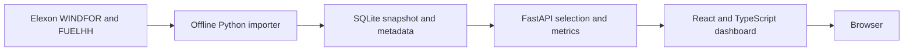

# Wind Decision Replay

A historical dashboard for a UK utility's day-ahead electricity buying team. Replay a January 2026 purchasing decision, inspect the wind forecast available at that time, and compare it with the wind generation that was subsequently recorded.

The pilot uses only Elexon's `WINDFOR` forecasts and `FUELHH` wind actuals. It supports a purchasing discussion with measured forecast errors; it does not calculate a utility's exact purchases, customer demand, or financial exposure.

**Live application:** [wind-decision-replay.vercel.app](https://wind-decision-replay.vercel.app) · React frontend and Python API, verified without login.

**Repository:** [Bishwajit05/qxvnr7](https://github.com/Bishwajit05/qxvnr7).

**Video:** an 8:42 narrated demo has been produced locally, with a 4:09 customer presentation and 4:33 technical review. YouTube upload is deferred; the submission requires an unlisted YouTube link. See [the walkthrough script](docs/demo-script.md) and [reproducible video pipeline](demo/README.md).



## Run locally

Requirements: Docker with Compose. The historical SQLite snapshot is included, so starting the application does not require an Elexon request or an API key.

```sh
docker compose up --build
```

Open [http://localhost:8000](http://localhost:8000). Stop with `docker compose down`. The frontend and API share one origin. The health endpoint is [http://localhost:8000/health](http://localhost:8000/health).

For development without Docker, use Python 3.12 or later and Node.js 22:

```sh
python -m venv .venv
source .venv/bin/activate
python -m pip install -r backend/requirements.txt
cd frontend
npm ci
npm run build
cd ..
uvicorn backend.app.main:app --reload --host 0.0.0.0 --port 8000
```

The built React app is served by FastAPI at the same address. In a second terminal, `cd frontend && npm run dev` starts Vite for frontend development; its API proxy points at the local Python server.

## What the dashboard explains

- **Decision replay:** choose a purchasing date in January 2026 and a decision time in Europe/London. Inspect the next day's wind forecast and its publication timestamps.
- **Forecast accuracy:** compare forecast and recorded generation in MW, with MAE, RMSE, bias, and coverage based on matched observations.
- **Forecast revisions:** replay eligible publication checkpoints and compare the selected forecast with each target hour's previous eligible revision. The improvement comparison uses only hours available in both versions and in the actuals.
- **Data quality:** inspect gaps, publication age, and source coverage rather than treating missing observations as zero.

The default 09:00 Europe/London cutoff is a configurable demonstration assumption. It is not presented as a universal UK auction deadline.

## Data and methodology

**Decision dates and delivery dates.** The assignment scopes decisions made from 1 through 31 January 2026. For next-day delivery, this means generation from 2 January through 1 February 2026. A decision on 31 January therefore includes 1 February delivery.

**Forecast availability.** For each delivery hour, choose the forecast with the greatest `publishTime` less than or equal to the selected decision timestamp. Retain all historical forecast versions so that later revisions cannot leak into an earlier decision. `publishTime` is a proxy for availability; recipient-specific network and delivery latency is unknown.

**Resolution and units.** The source forecasts are hourly MW values. Recorded `FUELHH` wind generation is half-hourly MW. An hourly actual is the arithmetic mean of its two half-hour values; it is included only when both half-hours exist. Averaging power preserves its MW unit. For a complete one-hour interval, an MW error multiplied by one hour gives an MWh mismatch.

**Error sign.** Signed error is `forecast MW − actual MW`. A positive bias means wind was overforecast. MAE is the mean absolute error; RMSE gives more weight to large misses. These are calculated on valid forecast/actual pairs only, and the interface reports the matched sample size and coverage. Missing values remain null and are excluded from metrics. An unavailable metric is not displayed as zero.

**Revision comparison.** Comparing forecasts on different sets of hours can mislead. At the selected checkpoint, each target hour's latest and previous eligible revisions are scored on a common cohort where both forecasts and the actual are available. Publication timestamps may differ across target hours; the previous series is not assumed to represent one uniform earlier decision time. A later revision is not assumed to be better; the data determines its measured change.

**Source scope.** The Elexon series describes GB metered wind coverage. It is not a measurement of every UK wind installation, including all embedded and unmetered generation. An energy mismatch is a forecast discrepancy, not a direct procurement requirement or a financial loss.

Sources: [WINDFOR endpoint documentation](https://bmrs.elexon.co.uk/api-documentation/endpoint/datasets/WINDFOR/stream), [FUELHH endpoint documentation](https://bmrs.elexon.co.uk/api-documentation/endpoint/datasets/FUELHH/stream), and [Elexon wind generation coverage](https://bmrs.elexon.co.uk/wind-generation).

### Reproduce the data snapshot

The application reads `data/wind.sqlite` without runtime writes. `data/metadata.json` records retrieval timestamps, request URLs, record counts, transformations, and checksums.

```sh
python scripts/import_data.py
```

The importer downloads source windows and caches their original responses under the ignored `data/raw/` directory. Use `python scripts/import_data.py --refresh` to re-download them. Forecast requests filter by publication time, while the importer separately restricts delivery times. It fetches earlier publications needed at the beginning of January, filters actuals to `fuelType=WIND`, deduplicates records, and retains forecast revisions. It replaces the snapshot only after a successful complete import. Re-fetching can produce different results if the upstream historical data has been revised; retain the metadata and checksums when comparing snapshots.

## Architecture



The separation is deliberately small: ingestion handles the external source, the backend owns forecast selection and analysis, and the frontend renders API results and controls. Metrics remain in Python so charts and summary cards use the same definitions. A historical read-only dataset needs no external database, authentication, job queue, or runtime data refresh.

Locally, one multi-stage Docker image builds the frontend and runs Uvicorn, with FastAPI serving the static frontend and API. Vercel serves the Vite build from its CDN and runs the same FastAPI application through `api/index.py`. The snapshot is packaged with the function. There is no mutable local state to preserve between function invocations.

## Files and directories

| Path | Purpose |
| --- | --- |
| `frontend/` | React, TypeScript, Vite, dashboard components, and styles |
| `backend/app/` | FastAPI application, forecast selection, metrics, and data access |
| `backend/tests/` | Domain and API regression tests |
| `backend/requirements.txt` | Python dependencies |
| `scripts/import_data.py` | Reproducible Elexon download and normalization |
| `data/wind.sqlite` | Committed historical data snapshot |
| `data/metadata.json` | Provenance, coverage, source requests, and checksums |
| `api/index.py` | Vercel Python entrypoint exporting the ASGI app |
| `Dockerfile`, `compose.yaml` | Build and run the entire app locally |
| `vercel.json`, `requirements.txt` | Vercel build, function, and routing configuration |
| `.github/workflows/ci.yml` | Python tests and frontend production build on pushes and pull requests |
| `docs/` | Walkthrough script, submission checklist, and implementation notes |

## Checks

```sh
python -m pytest backend/tests -q
cd frontend
npm ci
npm run build
```

The production frontend build includes TypeScript checks. Backend tests focus on meaningful risks: forecast availability at a cutoff, missing observations, temporal alignment, metric definitions, date boundaries, and comparable revision cohorts. Run the commands to obtain current results; this README does not substitute for their output.

The interactive API reference is available at `/docs`. Example requests:

```sh
curl 'http://localhost:8000/api/replay?decision_date=2026-01-15&cutoff=09:00'
curl 'http://localhost:8000/api/accuracy?cutoff=09:00'
curl 'http://localhost:8000/api/metadata'
curl 'http://localhost:8000/api/replay.csv?decision_date=2026-01-15&cutoff=09:00'
```

An optional `publication` parameter on replay and CSV requests selects an ISO timestamp checkpoint at or before the chosen decision cutoff.

## Deploy on Vercel

From the repository root, connect the repository or use the Vercel CLI:

```sh
vercel
vercel --prod
```

Keep the project root at the repository root. The checked-in configuration installs and builds `frontend/`, serves its `dist/` directory, and routes `/api/*` to the Python function. Root `requirements.txt` contains self-contained dependency pins for Vercel; keep them aligned with `backend/requirements.txt`. `includeFiles` packages the backend, snapshot, metadata, and built frontend. No secrets or extra database are required.

After deployment, verify the root page, a chart backed by the Python API, and `/health` while signed out. Confirm the deployment does not require a Vercel login before adding its URL above. Vercel executes Python functions rather than this project's Docker image; Docker remains the reproducible local delivery path. See [Vercel Python runtime documentation](https://vercel.com/docs/functions/runtimes/python) and [Vercel FastAPI documentation](https://vercel.com/docs/frameworks/backend/fastapi).

## AI assistance and time limit

Developed with assistance from OpenAI Codex. AI assistance covered research, implementation, documentation, and verification. The local demo uses macOS Daniel synthetic narration over real application captures and actual source excerpts; it includes captions and a two-part walkthrough. The implementation was checked with 20 backend tests, TypeScript and production builds, dependency audit, a running Docker container, and unauthenticated production API requests.

The assignment sets a maximum of 16 hours. The implementation is scoped to a read-only historical pilot; [the work log](docs/work-log.md) records the development session and remaining submission items. Use [docs/submission-checklist.md](docs/submission-checklist.md) to finish the YouTube and personal-detail steps before submitting.
