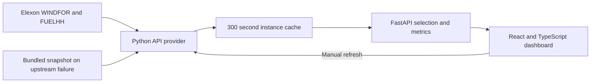

# Wind Decision Replay

A historical dashboard for a UK utility's day-ahead electricity buying team. Choose a January 2026 purchasing decision and immediately inspect the eligible wind forecast, recorded generation, and accuracy measures together. The backend retrieves the historical records from Elexon's real APIs and exposes their freshness and provenance.

The pilot uses only Elexon's `WINDFOR` forecasts and `FUELHH` wind actuals. It supports a purchasing discussion with measured forecast errors; it does not calculate a utility's exact purchases, customer demand, or financial exposure.

**Application:** [wind-decision-replay.vercel.app](https://wind-decision-replay.vercel.app). The updated API refresh workflow must be verified on the next production deployment; the prior release was accessible without login.

**Repository:** [Bishwajit05/qxvnr7](https://github.com/Bishwajit05/qxvnr7).

**Local video:** the existing 8:42 MP4 demonstrates the previous workflow and needs regeneration from fresh captures. Its narration source has been updated for immediate results and real API refresh. The video remains local at the candidate's request; no YouTube upload or form submission has been performed. See [the updated walkthrough script](docs/demo-script.md) and [video pipeline notes](demo/README.md).

The preview image in `docs/replay-preview.png` belongs to the prior release and should be replaced with a capture of the refreshed interface.

## Run locally

Requirements: Docker with Compose and outbound HTTPS access to Elexon. No API key is required. The first data request fetches the historical source windows. A bundled snapshot is available only as an explicitly labelled fallback if upstream retrieval fails.

```sh
docker compose up --build
```

Open [http://localhost:8000](http://localhost:8000). Stop with `docker compose down`. The frontend and API share one origin. The health endpoint is [http://localhost:8000/health](http://localhost:8000/health).

For development without Docker, use Python 3.12 or later and Node.js 22:

```sh
python -m venv .venv
source .venv/bin/activate
python -m pip install -r backend/requirements.txt
cd frontend
npm ci
npm run build
cd ..
uvicorn backend.app.main:app --reload --host 0.0.0.0 --port 8000
```

The built React app is served by FastAPI at the same address. In a second terminal, `cd frontend && npm run dev` starts Vite for frontend development; its API proxy points at the local Python server.

## What the dashboard explains

- **Decision replay:** choose a purchasing date in January 2026 and a decision time in Europe/London. Inspect the next day's wind forecast and its publication timestamps.
- **Immediate accuracy:** forecast and recorded generation, MAE, RMSE, bias, energy mismatch, and coverage appear as soon as data loads. There is no reveal or unlock step.
- **Forecast revisions:** replay eligible publication checkpoints and compare the selected forecast with each target hour's previous eligible revision. The improvement comparison uses only hours available in both versions and in the actuals.
- **Data quality:** inspect gaps, publication age, and source coverage rather than treating missing observations as zero.
- **Data refresh:** force a new request to the real Elexon APIs and inspect whether the results came from the API, its cache, or the fallback snapshot.

The default 09:00 Europe/London cutoff is a configurable demonstration assumption. It is not presented as a universal UK auction deadline.

## Data and methodology

**Decision dates and delivery dates.** The assignment scopes decisions made from 1 through 31 January 2026. For next-day delivery, this means generation from 2 January through 1 February 2026. A decision on 31 January therefore includes 1 February delivery.

**Forecast availability.** For each delivery hour, choose the forecast with the greatest `publishTime` less than or equal to the selected decision timestamp. Retain all historical forecast versions so that later revisions cannot leak into an earlier decision. `publishTime` is a proxy for availability; recipient-specific network and delivery latency is unknown.

**Resolution and units.** The source forecasts are hourly MW values. Recorded `FUELHH` wind generation is half-hourly MW. An hourly actual is the arithmetic mean of its two half-hour values; it is included only when both half-hours exist. Averaging power preserves its MW unit. For a complete one-hour interval, an MW error multiplied by one hour gives an MWh mismatch.

**Error sign.** Signed error is `forecast MW − actual MW`. A positive bias means wind was overforecast. MAE is the mean absolute error; RMSE gives more weight to large misses. These are calculated on valid forecast/actual pairs only, and the interface reports the matched sample size and coverage. Missing values remain null and are excluded from metrics. An unavailable metric is not displayed as zero.

**Revision comparison.** Comparing forecasts on different sets of hours can mislead. At the selected checkpoint, each target hour's latest and previous eligible revisions are scored on a common cohort where both forecasts and the actual are available. Publication timestamps may differ across target hours; the previous series is not assumed to represent one uniform earlier decision time. A later revision is not assumed to be better; the data determines its measured change.

**Source scope.** The Elexon series describes GB metered wind coverage. It is not a measurement of every UK wind installation, including all embedded and unmetered generation. An energy mismatch is a forecast discrepancy, not a direct procurement requirement or a financial loss.

Sources: [WINDFOR endpoint documentation](https://bmrs.elexon.co.uk/api-documentation/endpoint/datasets/WINDFOR/stream), [FUELHH endpoint documentation](https://bmrs.elexon.co.uk/api-documentation/endpoint/datasets/FUELHH/stream), and [Elexon wind generation coverage](https://bmrs.elexon.co.uk/wind-generation).

### API retrieval and freshness

The API provider retrieves the permitted historical source windows on the first request in a Python process. It retains one successful normalized dataset in memory for 300 seconds. Requests within that interval reuse it; after expiry, a new upstream retrieval is attempted. On Vercel, this cache belongs to one function instance. Different instances can have different cache ages, and a cold instance must perform its own retrieval. This is not a shared durable cache.

`GET /api/dashboard` returns `replay`, `accuracy`, `metadata`, and `data_status` from one dataset epoch, so cards and charts cannot silently mix independently refreshed datasets. `POST /api/refresh` returns the same response shape, bypasses the normal cache interval, and attempts a real upstream refresh. Refreshing does not widen the assignment's scope: it still retrieves January 2026 decisions, the necessary earlier publication buffer, and next-day delivery through 1 February.

The interface distinguishes `live_api`, `cached_api`, and `snapshot_fallback` through `data_status.mode`. Status includes `retrieved_at`, `last_refresh_attempt`, `cache_expires_at`, `stale`, `refresh_error`, `source_urls`, and `data_epoch`. A failed refresh does not erase the last successfully loaded API dataset or move its retrieval time forward. Automatic retries after failure are briefly limited to avoid repeated upstream requests; manual refresh retries immediately. If no successful API dataset is available and retrieval fails, the bundled snapshot is used with an explicit fallback label and its original provenance. Fallback data is never labelled as a successful fresh API response.

### Reproduce the fallback snapshot

The fallback is `data/wind.sqlite`, read without runtime writes. `data/metadata.json` records its original retrieval timestamps, request URLs, record counts, transformations, and checksums. Regenerating this optional packaged fallback is separate from the application's API refresh action.

```sh
python scripts/import_data.py
```

The importer downloads source windows and caches their original responses under the ignored `data/raw/` directory. Use `python scripts/import_data.py --refresh` to re-download them. Forecast requests filter by publication time, while the importer separately restricts delivery times. It fetches earlier publications needed at the beginning of January, filters actuals to `fuelType=WIND`, deduplicates records, and retains forecast revisions. It replaces the snapshot only after a successful complete import. Re-fetching can produce different results if the upstream historical data has been revised; retain the metadata and checksums when comparing snapshots.

## Architecture



The API provider handles external requests, validation, caching, and fallback. The backend owns forecast selection and analysis, while the frontend renders the unified response, freshness status, and controls. Metrics remain in Python so charts and summary cards use the same definitions. A historical dataset with a bounded cache needs no external database, authentication, or job queue for this pilot.

Locally, one multi-stage Docker image builds the frontend and runs Uvicorn, with FastAPI serving the static frontend and API. Vercel serves the Vite build from its CDN and runs the same FastAPI application through `api/index.py`. The emergency snapshot is packaged with the function; the live API cache is disposable process memory. No runtime files are required for persistence.

## Files and directories

| Path | Purpose |
| --- | --- |
| `frontend/` | React, TypeScript, Vite, dashboard components, and styles |
| `backend/app/` | FastAPI routes, real API provider, caching/fallback, forecast selection, and metrics |
| `backend/tests/` | Domain and API regression tests |
| `backend/requirements.txt` | Python dependencies |
| `scripts/import_data.py` | Reproducible Elexon download and normalization |
| `data/wind.sqlite` | Historical fallback snapshot used only after upstream retrieval failure |
| `data/metadata.json` | Fallback provenance, coverage, source requests, and checksums |
| `api/index.py` | Vercel Python entrypoint exporting the ASGI app |
| `Dockerfile`, `compose.yaml` | Build and run the entire app locally |
| `vercel.json`, `requirements.txt` | Vercel build, function, and routing configuration |
| `.github/workflows/ci.yml` | Python tests, React interaction tests, and frontend production build |
| `docs/` | Walkthrough script, submission checklist, and implementation notes |

## Checks

```sh
python -m pytest backend/tests -q
cd frontend
npm ci
npm run test
npm run build
```

The production frontend build includes TypeScript checks. Backend tests cover source retrieval and cache/failure semantics as well as forecast availability, missing observations, temporal alignment, metric definitions, date boundaries, and comparable revision cohorts. Frontend interaction tests cover immediate result visibility and refresh state. Run the commands to obtain current results; verification of this revision is not implied by the earlier release's test results.

The interactive API reference is available at `/docs`. Example requests:

```sh
curl 'http://localhost:8000/api/dashboard?decision_date=2026-01-15&cutoff=09:00'
curl -X POST 'http://localhost:8000/api/refresh?decision_date=2026-01-15&cutoff=09:00'
curl 'http://localhost:8000/api/replay.csv?decision_date=2026-01-15&cutoff=09:00'
```

An optional `publication` parameter selects an ISO timestamp checkpoint at or before the chosen decision cutoff. A refresh retrieves updated historical records; it never allows a publication after that cutoff into the decision.

## Deploy on Vercel

From the repository root, connect the repository or use the Vercel CLI:

```sh
vercel
vercel --prod
```

Keep the project root at the repository root. The checked-in configuration installs and builds `frontend/`, serves its `dist/` directory, and routes `/api/*` to the Python function with a 60-second maximum duration. Root `requirements.txt` contains self-contained dependency pins for Vercel; keep them aligned with `backend/requirements.txt`. `includeFiles` packages the backend, fallback snapshot, metadata, and built frontend. No secrets or extra database are required. Outbound Elexon access is required for a fresh API result.

After deployment, verify the root page, immediate actuals and metrics, `/health`, a cold API load, a cached load, and a manual refresh while signed out. Confirm the returned status identifies the real source and any retrieval failure. A public URL alone does not prove that upstream refresh works. Vercel executes Python functions rather than this project's Docker image; Docker remains the reproducible local delivery path. See [Vercel Python runtime documentation](https://vercel.com/docs/functions/runtimes/python) and [Vercel FastAPI documentation](https://vercel.com/docs/frameworks/backend/fastapi).

## AI assistance and time limit

Developed with assistance from OpenAI Codex. AI assistance covered research, implementation, documentation, and verification. The previous local demo used macOS Daniel synthetic narration over real application captures and actual source excerpts. It must be regenerated to show the current immediate-results and API-refresh workflow. The work log distinguishes checks executed for the earlier release from validation still required for this revision.

The assignment sets a maximum of 16 hours. The implementation remains a January 2026 historical pilot; [the work log](docs/work-log.md) records the development session and remaining checks. The video stays local and the form remains unsubmitted at the candidate's request. Future submission requirements are listed in [docs/submission-checklist.md](docs/submission-checklist.md); contact details, LinkedIn, and resume links are not stored in this public repository.
